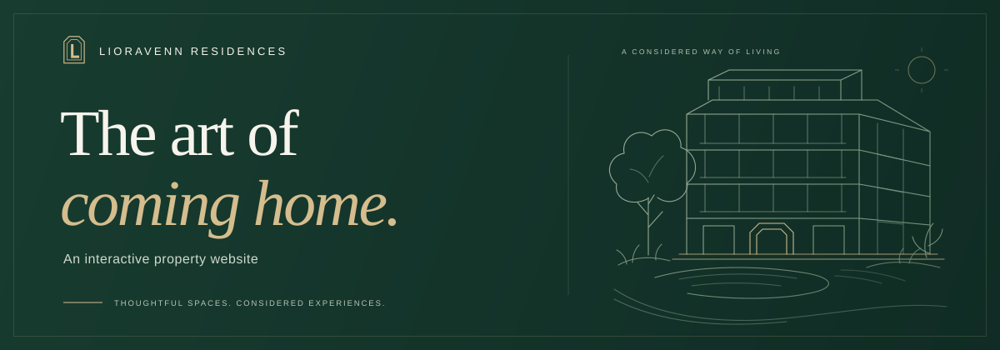
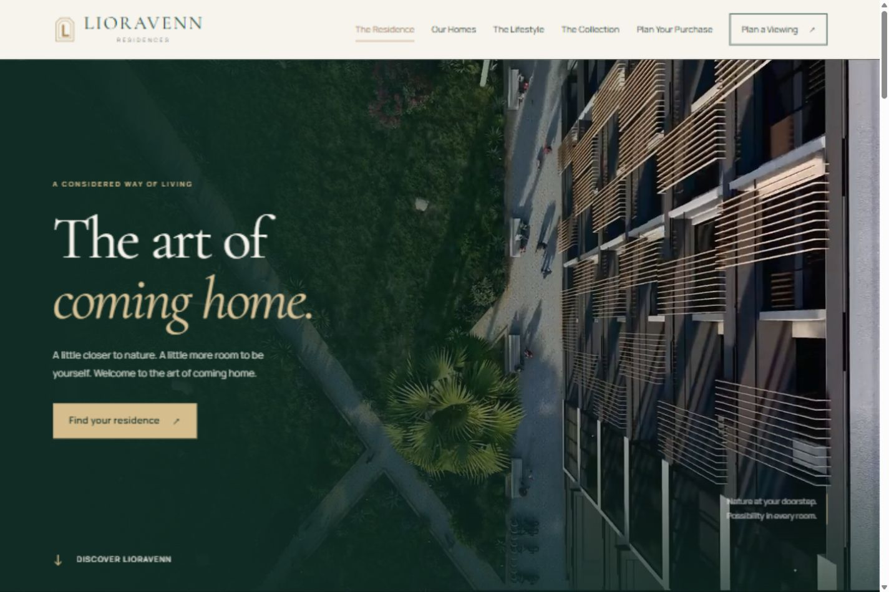
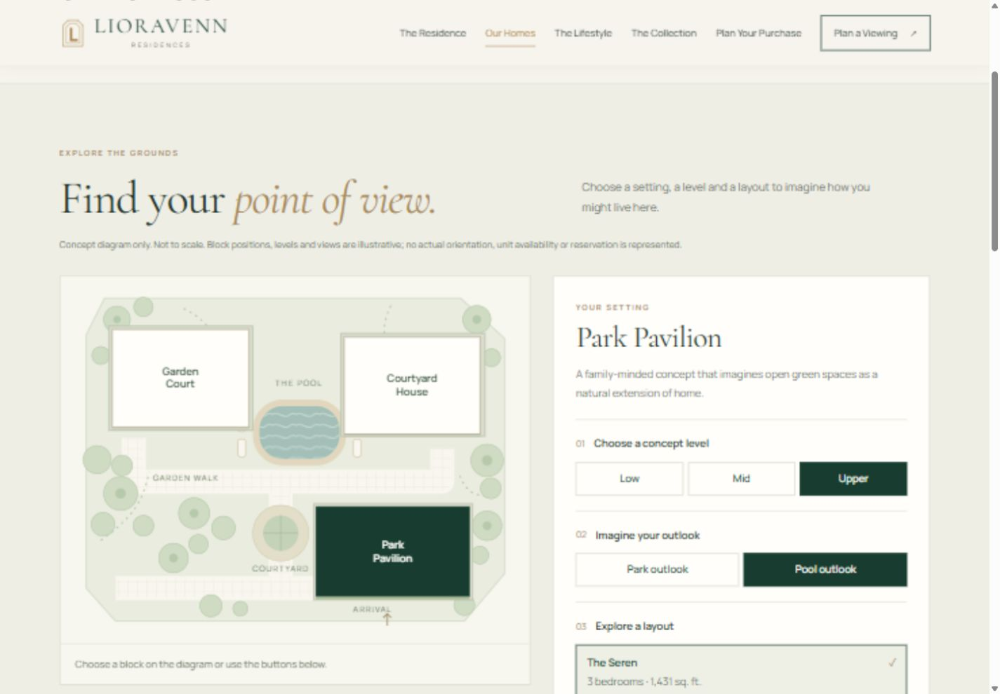
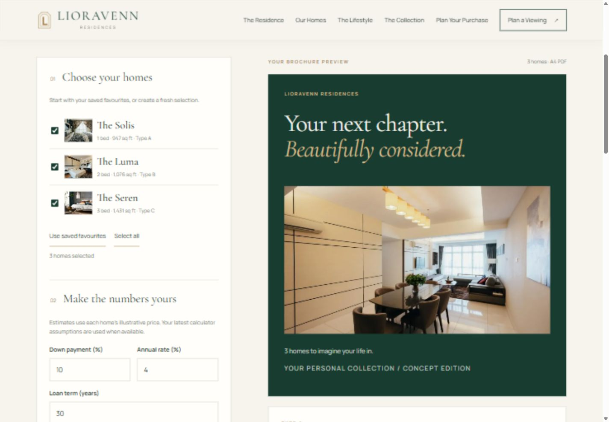
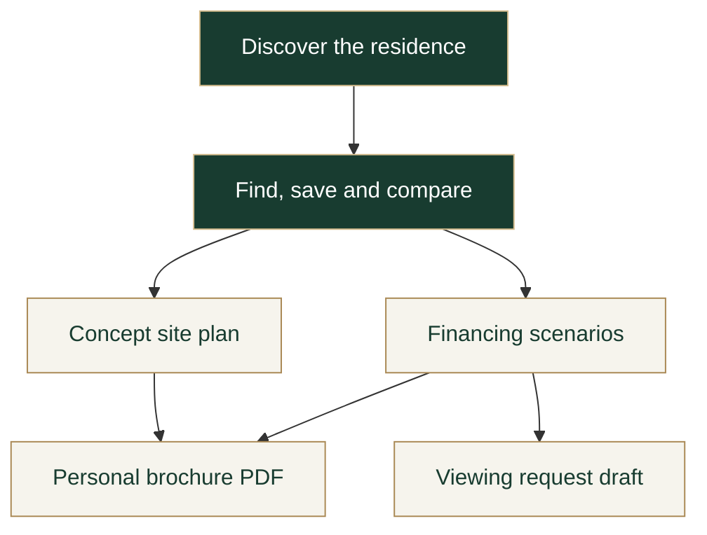

<p align="center">
  
</p>

<h1 align="center">Lioravenn Residences</h1>

<p align="center">
  A nature-inspired property website that turns browsing into a personal collection.<br>
  Reimagined from a university project with thoughtful design and connected interactions.
</p>

<p align="center">
  <a href="https://chrystalfsc.github.io/lioravenn-residences/"><strong>Explore the live website ↗</strong></a>
  &nbsp; · &nbsp;
  <a href="#the-experience">The experience</a>
  &nbsp; · &nbsp;
  <a href="#run-it-locally">Run locally</a>
  &nbsp; · &nbsp;
  <a href="docs/DEVELOPMENT.md">Development guide</a>
</p>

<p align="center"><strong>HTML5 &nbsp; / &nbsp; CSS3 &nbsp; / &nbsp; Vanilla JavaScript &nbsp; / &nbsp; jsPDF</strong></p>

<p align="center">
  <a href="https://chrystalfsc.github.io/lioravenn-residences/">
    
  </a>
  <br>
  <sub>Silent garden footage, editorial typography, and a calmer first impression. Click to explore.</sub>
</p>

| Explore | Compare | Experience | Take away |
| :---: | :---: | :---: | :---: |
| **7 pages** | **3 home layouts** | **2 ambient video loops** | **Your own PDF brochure** |
| One connected journey | Original Type A, B & C plans | Adaptive MP4 delivery | Generated on your device |

## The experience

The goal is to help a visitor move from *“I like the feeling of this place”* to *“this is the home I want to explore.”* The planning tools carry home selections from page to page.

| Feature | What you can do |
| :--- | :--- |
| **Find your home** | Filter by bedroom count and budget, save favourites, compare layouts, and open the original floor plans. |
| **Choose a setting** | Explore a concept site diagram, then select a building, level, outlook, and compatible home layout. |
| **Explore your numbers** | Adjust down payment, rate, and term; compare up to three saved financing scenarios. |
| **Make it personal** | Build an A4 brochure with selected homes, plans, financing estimates, a concept setting, and viewing questions. |
| **Step inside** | Browse a filterable gallery, open larger photos, and switch between four spaces in the room explorer. |
| **Move through the story** | Scroll through lightweight one-time reveals, gentle desktop image movement, reading progress, and chapter navigation. |

### A closer look

<table>
  <tr>
    <td width="50%" valign="top">
      <a href="https://chrystalfsc.github.io/lioravenn-residences/floor-plans.html#site-plan">
        
      </a>
      <br><strong>Find your point of view</strong><br>
      Explore a setting and carry it into your brochure.
    </td>
    <td width="50%" valign="top">
      <a href="https://chrystalfsc.github.io/lioravenn-residences/brochure.html">
        
      </a>
      <br><strong>A collection, made personal</strong><br>
      Turn your shortlist into a downloadable A4 PDF.
    </td>
  </tr>
</table>

*Screenshots show the working interface. Buildings, prices, outlooks, and imagery belong to a fictional development concept.*

## One journey, connected choices



Home selections travel through page URLs. Saved favourites and valid calculator assumptions can be reused in the brochure; a visitor can also start with a fresh selection.

## Design with a sense of place

**Forest green · Warm ivory · Brass**

The original portal-shaped **L** monogram, Cormorant Garamond headings, and Manrope body text create a consistent identity across the website and exported brochure.

- **Responsive layouts:** the same tools adapt to desktop and phone screens.
- **Considered motion:** native scrolling, restrained transitions, and an Auto / On / Off control alongside reduced-motion and data-saving support.
- **Keyboard access:** skip links, focus handling, accessible dialogs, and keyboard-operated room tabs.
- **Sharper imagery:** high-quality WebP assets with preserved originals and [documented AI-restoration provenance](img/enhanced/README.md).

## Under the surface

| Layer | Implementation |
| :--- | :--- |
| **Interface** | Semantic HTML, CSS Grid/Flexbox, shared styles, and page-specific stylesheets. |
| **Interactions** | Plain JavaScript for filtering, comparison, dialogs, site selections, gallery tabs, and form validation. |
| **Shared state** | A shared home catalogue, URL parameters, and browser storage for non-personal selections and scenarios. |
| **Motion & media** | IntersectionObserver, requestAnimationFrame, responsive images, MP4/WebM video, and still-image fallbacks. |
| **Documents** | Bundled jsPDF generates the brochure locally, including pagination for long viewing questions. |
| **Delivery** | Static files hosted on GitHub Pages. No framework or build step is required. |

See the [development guide](docs/DEVELOPMENT.md) for page routes, data flow, media preparation, PDF behavior, and implementation limits.

## Run it locally

```bash
git clone https://github.com/ChrystalFSC/lioravenn-residences.git
cd lioravenn-residences
python -m http.server 8765 --bind 127.0.0.1
```

Open **[localhost:8765](http://127.0.0.1:8765/)**. Python 3 is only used to serve the files; the website itself runs in the browser.

<details>
<summary><strong>Verification commands and coverage</strong></summary>

Run from the repository root with Python 3 and Node.js installed. No package installation is needed.

```bash
python scripts/check-site.py
node tests/floor-plans.test.cjs
node tests/site-plan.test.cjs
node tests/brochure-model.test.cjs
node tests/brochure-pdf.test.cjs
node tests/scroll-motion.test.cjs
node tests/ambient-videos.test.cjs
node tests/motion-preferences.test.cjs
```

| Check | Focus |
| :--- | :--- |
| Static audit | Seven active pages, exact-case assets, links, anchors, headings, branding, and JavaScript syntax. |
| Home finder | Filters, saved homes, comparisons, and layout interactions. |
| Concept site plan | Supported selections, shared settings, and DOM behavior. |
| Brochure models | Financing validation, selection continuity, and safe note handling. |
| PDF generation | Long-note pagination, multilingual notes, wrapping, and page bounds. |
| Scroll motion | One-time reveals, bidirectional chapter/progress updates, device limits, reduced-motion changes, focus, and layout fallbacks. |
| Ambient video | Adaptive sources, visibility/buffering, blocked-autoplay recovery, source fallback, and live preferences. |
| Motion preferences | Explicit choices, device settings, local persistence, shared events, and unavailable-storage fallback. |

Browser checks also cover desktop/phone layouts, full-resolution gallery images, silent video playback, and actual PDF downloads. Exported PDFs were rendered for visual inspection.

</details>

## Project story & credits

This began as a **group assignment for CSS 3333 Web Technology at UTS (University of Technology Sarawak)**, Year 2 Semester 2. My original contribution was the contact page, including Google Forms integration, FAQ, Google Maps, and validation.

The later portfolio refinement was developed with AI assistance and expands the project with the Lioravenn identity, redesigned pages, connected selection tools, scroll motion, and personal brochure export. The original group work and floor-plan assets remain part of that history.

**Concept scope:** this is an academic demonstration. Viewing requests create local drafts; no enquiry is sent and no appointment or unit is reserved. Financing uses editable fixed-rate illustrations. The room explorer uses photographs rather than a 360° model, and AI-restored imagery conveys a design mood rather than verified property detail.

Third-party PDF code retains its [jsPDF license and provenance](js/vendor/README.md). Media sources, original files, and restoration details are documented in the [development guide](docs/DEVELOPMENT.md) and [image notes](img/enhanced/README.md).
